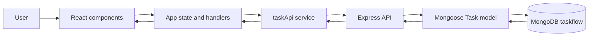

# Architecture

## Runtime pieces

- `src/main.jsx` mounts React; `src/App.jsx` owns shared task, form, filter, and request state.
- `src/components/` renders the form, counts, schedule, and task actions.
- `src/services/taskApi.js` sends HTTP requests and turns unsuccessful JSON responses into errors.
- `src/utils/tasks.js` handles due-date sorting and date input/display formatting.
- `server/server.js` defines the Mongoose model, Express routes, error handling, connection startup, and production static hosting.
- MongoDB stores `Task` records in the `taskflow` database.

## Data flow

On mount, the page calls GET /api/tasks. The effect aborts the request on unmount to avoid stale state updates. Create uses POST; edits and status changes use PATCH; removal uses DELETE. Successful mutation responses update React state, then the list is sorted by due date. Filtering happens in the browser and does not alter the API.

## Development and production

Vite serves frontend source and proxies /api to Express at localhost:3000 during development. In production, `npm run build` writes `dist/`, and Express serves that folder alongside the API. Express connects to MongoDB before listening. `ATLAS_URI` supplies the connection string and `PORT` controls the listener (default 3000).

## Data validation and errors

The schema requires title and dueDate, trims and caps title at 160 characters, and limits priority/status to supported values. PATCH accepts only those four fields and runs validators. Validation and bad ID errors map to 400; missing task records map to 404; unexpected errors return generic 500 JSON and are logged.

## Scope

No authentication, ownership model, AI/voice integration, router, migrations, or deployment manifests are configured.
