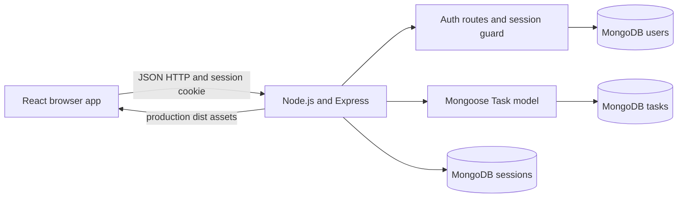
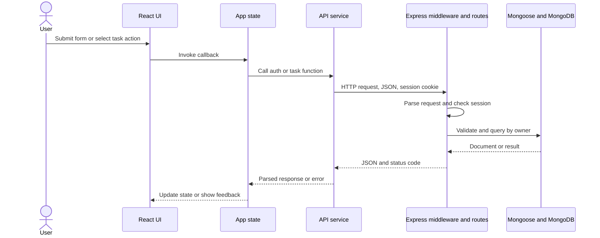
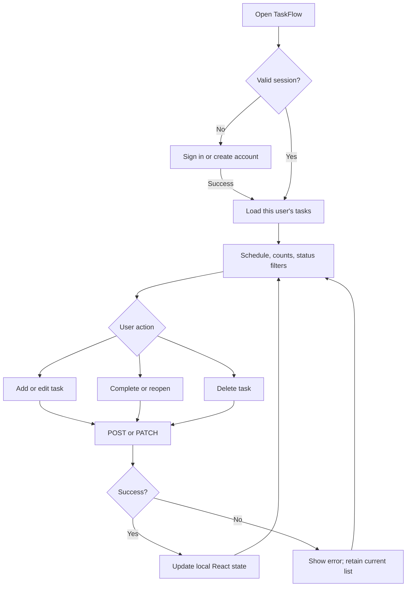

# Architecture

## High-level design

TaskFlow has a browser client, an Express REST API, and MongoDB. The API authenticates users with server-side sessions and checks task ownership for every protected operation.



## System architecture and data flow

- Presentation: React components and responsive CSS.
- Application: App owns user, task, form, filter, and loading/error state.
- API client: authApi and taskApi centralize browser requests and response errors.
- Server: Express parses JSON, loads sessions, routes API calls, and returns JSON.
- Data: Mongoose schemas validate User and Task; MongoDB stores users, tasks, and sessions.
- Hosting: Vite proxies API in development. Express serves dist and API in production.



## Authentication flow

```mermaid
sequenceDiagram
 actor User
 participant UI as AuthPanel
 participant API as Auth routes
 participant UserDB as MongoDB User
 participant SessionDB as MongoStore
 User->>UI: Submit email/password
 UI->>API: POST register or login
 API->>UserDB: Create hash or compare submitted password
 UserDB-->>API: User record
 API->>API: Regenerate session ID; record userId
 API->>SessionDB: Save session
 API-->>UI: HttpOnly cookie and public user data
 UI->>API: GET /api/auth/me on next visit
 API->>SessionDB: Load session
 API-->>UI: Current user or 401
```

The browser does not get the password hash or session object. It holds the opaque HttpOnly cookie; JavaScript cannot read it.

## UX and application flow



The status filters run in React over the loaded task list; they do not change API routes.

## Database and errors

User has a normalized unique email and passwordHash. Task has title, dueDate, priority, status, owner reference, and timestamps. The compound owner/dueDate index supports per-account schedule reads. Session records expire after seven days.

Every task read/update/delete includes the session user ID. New tasks take owner from the session rather than request JSON. Validation and invalid IDs return 400; duplicate email returns 409; missing/non-owned tasks return 404; no session returns 401; unexpected errors are logged and return a generic 500.

Legacy records without owner are hidden until the deliberate migration command assigns them to a chosen account.

## Configuration and deployment

ATLAS_URI connects MongoDB, SESSION_SECRET signs session identifiers, and PORT chooses the HTTP port (default 3000). In production, NODE_ENV=production enables Secure cookies; serve through HTTPS and configure the trusted proxy. Do not commit .env.
