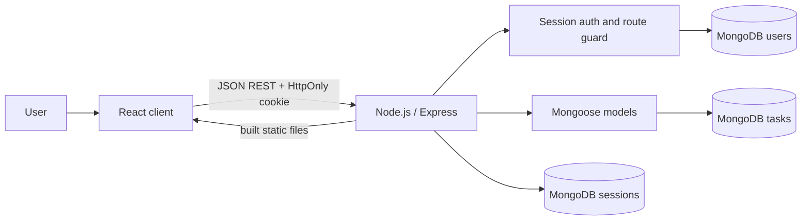
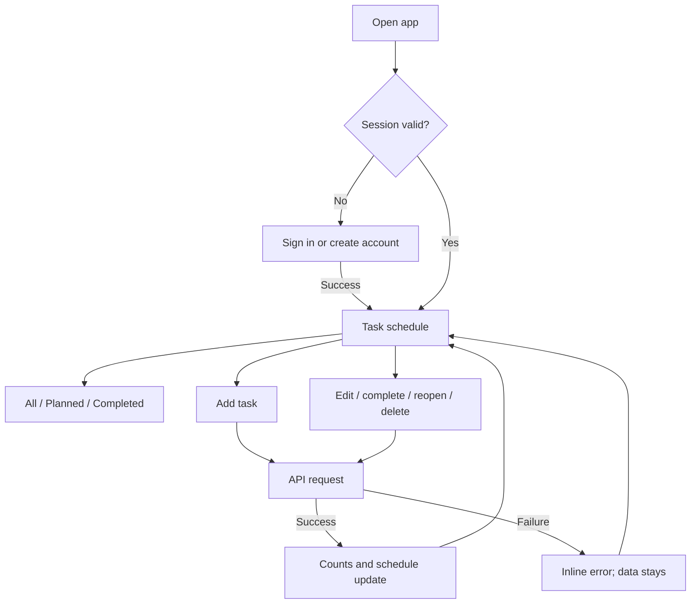
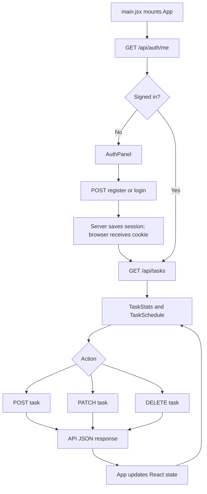
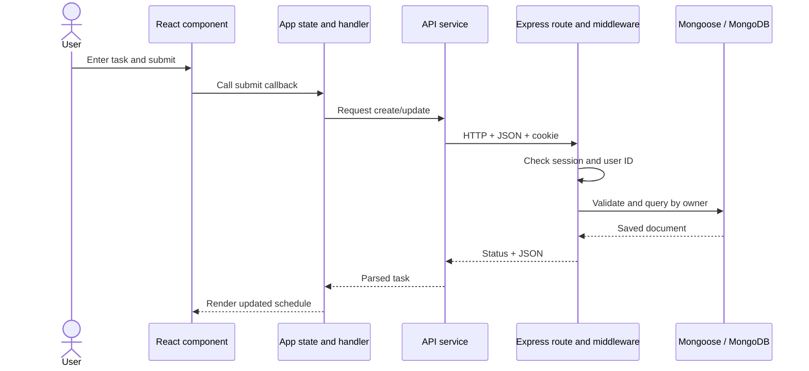

# TaskFlow — Assessment Guide

## 60-second summary

“TaskFlow is a full-stack due-date scheduler. React renders a controlled task form and schedule. The browser calls a same-origin REST API built with Node.js and Express. Mongoose validates data in MongoDB. Passwords are hashed, sessions are stored server-side, and each task query is scoped to the signed-in user.”

## High-level design

## UX flow

## Application flow

## Data flow

## CRUD mapping

| User action | React module | REST request | MongoDB behavior |
|---|---|---|---|
| View | App loads list | GET /api/tasks | Find records for signed-in owner |
| Create | TaskForm | POST /api/tasks | Validate fields, set owner from session, insert |
| Edit | TaskCard then TaskForm | PATCH /api/tasks/:id | Update allowed fields for ID and owner |
| Complete/reopen | TaskCard | PATCH /api/tasks/:id | Change status for owned record |
| Delete | TaskCard | DELETE /api/tasks/:id | Delete only the owned record |

The list changes after a successful API response. Failed requests display feedback and keep the current item.

## React concepts

- Components: focused UI functions such as TaskForm and TaskCard.
- Props: values and callbacks passed from App into child components.
- State: current user, tasks, form draft, filter, loading, saving, and error.
- Controlled inputs: input values come from React state; onChange updates it.
- useEffect: checks the session and loads tasks; AbortController cancels stale list requests.
- useMemo: derives the visible tasks for the selected filter.
- Immutable updates: map/filter create new arrays so React can render state changes.
- Conditional rendering: auth screen, loading message, empty state, and errors.

## HTML and CSS

HTML provides the document root, headings, forms, labels, inputs, buttons, and navigation. Labels identify their fields, and task controls have accessible names. CSS Grid/Flexbox arrange the dashboard; media queries adapt it for mobile. The existing palette and layout stay the same after authentication is added.

## JavaScript

ES modules separate functionality. Objects hold form/task data; map/filter derive lists; async/await handles requests; try/catch/finally manages errors and saving state. Fetch sends HTTP and JSON. Date helpers convert database dates to input/display forms.

## Node.js, Express, and REST

Node.js runs the server JavaScript outside the browser. Express middleware parses JSON and sessions before routes. Routes match HTTP method and path to handlers. URL params identify records; session data identifies the user. GET reads, POST creates, PATCH partially updates, and DELETE removes. JSON carries request and response data. Status codes include 200/201 success, 400 invalid input, 401 not signed in, 404 missing/non-owned task, 409 duplicate email, and 500 unexpected server error.

## MongoDB and Mongoose

MongoDB stores documents in collections. Mongoose schemas specify required fields, enums, indexes, and references. User has a unique normalized email and password hash. Task has an owner reference and task fields. The server filters by both task ID and owner ID to prevent cross-account reads/writes. MongoStore stores session records with expiry.

## Authentication flow

1. Registration validates email/password and hashes the password with bcryptjs.
2. Login compares the submitted password to the saved hash. Error text does not reveal whether the email exists.
3. The server regenerates a session ID after successful login/registration and stores userId server-side.
4. MongoStore persists the session. Browser holds only an HttpOnly, SameSite=Lax cookie.
5. requireAuth rejects task calls without a session.
6. Task routes add the authenticated user ID to every database condition.

TaskFlow uses cookie sessions, not JWT. HTTPS is needed in production for Secure cookies.

## Demo sequence

1. Register a new account and refresh to show session persistence.
2. Add tasks with different due dates and priority.
3. Use All/Planned/Completed filters.
4. Edit a task, complete it, reopen it, and delete one.
5. Sign out, sign in again, and show tasks persist.
6. Explain the PATCH route's owner constraint.

Old tasks created before accounts were added have no owner. If the user wants them under one account, create that account and run the documented migration only after confirming ownership.

## Limitations

No automated tests/lint, email verification, password reset, rate limiting, MFA, account deletion, or deployment pipeline is configured. Production requires HTTPS, MongoDB, ATLAS_URI, SESSION_SECRET, and appropriate proxy configuration.
